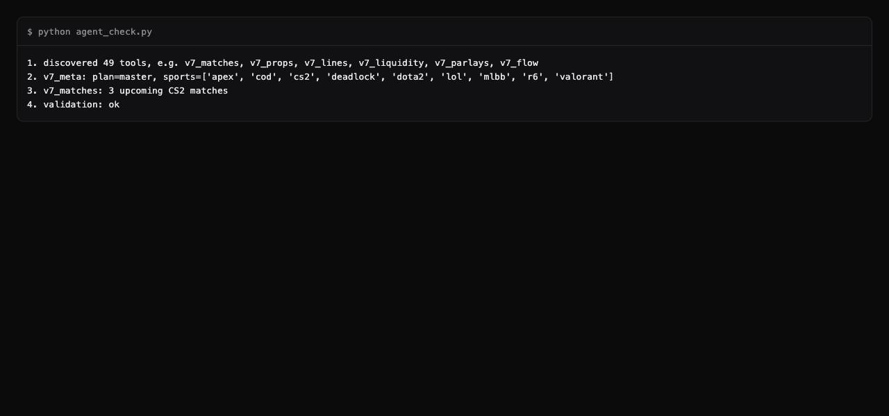

# AI Agent Example

What a coding agent does with the KashRock MCP server, as a script you can run. It connects to the hosted server, lists the tools an agent would see, reads the key's plan with `v7_meta`, calls one data tool, and checks the result.



**Plan:** any plan, including the free Sandbox (no card). `v7_meta` and `v7_matches` are match discovery. Other tools follow your plan's limits. See [pricing](https://www.kashrock.com/pricing).

## Setup

```bash
pip install -r requirements.txt
cp .env.example .env     # put your key in KASHROCK_API_KEY
python agent_check.py
```

`KASHROCK_MCP_URL` overrides the server (default `https://mcp.kashrock.com/mcp`).

## Use it from your own agent

Point your MCP client at `https://mcp.kashrock.com/mcp` with the header `x-api-key: <your key>`. Then give the agent the skill file: <https://www.kashrock.com/SKILL.md>. Setup per client (Claude Code, Cursor, Codex and others) is in the [MCP guide](https://www.kashrock.com/docs/mcp). The [agents page](https://www.kashrock.com/agents) has a copy-paste prompt.

Docs: [MCP](https://www.kashrock.com/docs/mcp), [Quickstart](https://www.kashrock.com/docs/quickstart), [llms.txt](https://www.kashrock.com/llms.txt).
