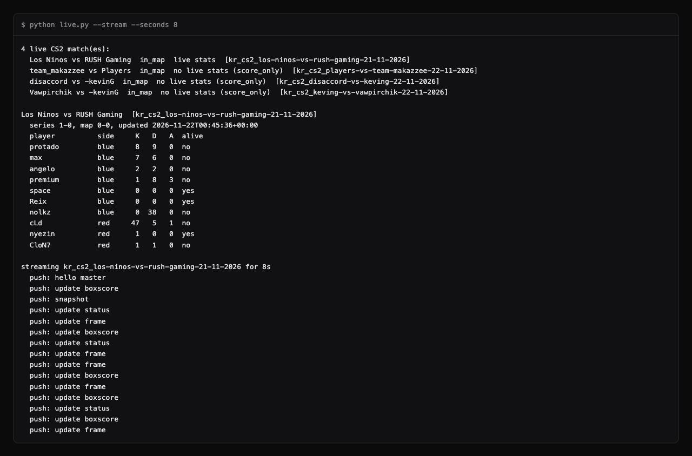

# CS2 Live Dashboard

Lists every live CS2 match, prints the score and each player's kills, deaths and assists for one match, then follows that match over the live WebSocket. Every row comes from the live API.



**Plan:**
- Live REST board: Hobby or above. Hobby is 15 seconds behind; Builder, Pro and Quant are real time.
- `--stream` (WebSocket): Builder or above. Builder allows 2 connections and 5 matches.

See [pricing](https://www.kashrock.com/pricing).

A match can be live with no player stats (`has_live_stats: false`, for example `reason: score_only`). The dashboard prints that reason. No plan adds coverage for a match that has none.

## Setup

```bash
pip install -r requirements.txt
cp .env.example .env               # put your key in KASHROCK_API_KEY
python live.py                     # live matches + one board
python live.py --stream --seconds 30
```

## What it calls

1. `GET /v7/cs2/live` lists every live match: state, whether it has live stats, and streams.
2. `GET /v7/cs2/live?game=<kr_match_id>&include=boxscore` reads the score and player rows.
3. `WS /v7/live/ws` with the `x-api-key` header, then sends `{"op":"subscribe","sport":"cs2","game_id":"<kr_match_id>"}`. It prints each push (`hello`, `snapshot`, `update`).

A browser cannot set headers on a socket. There, get a short ticket from `POST /v7/ws-ticket` and connect with `?ticket=`.

Docs: [Live data](https://www.kashrock.com/docs/live-data), [WebSockets](https://www.kashrock.com/docs/websockets).
