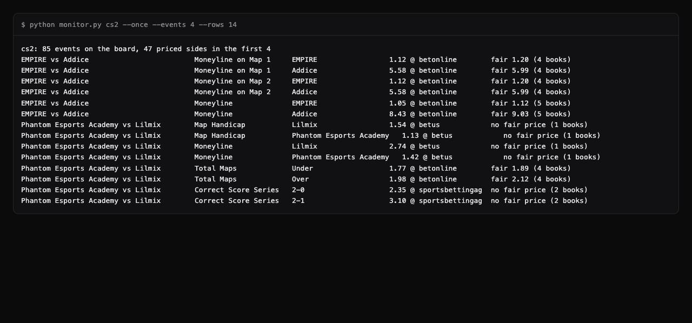

# Esports Odds Monitor

Prints the best price for each side of every market across books, next to the consensus fair price. Each poll after that shows which best prices moved. Every row comes from the live API.



**Plan:** Hobby or above (team lines are not on Sandbox). See [pricing](https://www.kashrock.com/pricing).

## Setup

```bash
pip install -r requirements.txt
cp .env.example .env          # put your key in KASHROCK_API_KEY
python monitor.py cs2 --once  # one board
python monitor.py cs2         # keep polling every 60s, Ctrl+C to stop
```

Options: `--events 10` events per poll, `--rows 20` rows printed, `--every 60` seconds between polls. Any title works: `cs2`, `lol`, `dota2`, `valorant` and the rest listed by `GET /v7/meta`.

## What it calls

- `GET /v7/{sport}/lines?limit=N`. Each price has `source`, `decimal`, `observed_at` and `suspended`; each side has `fair_decimal`.
- Suspended prices are not counted as the best price.
- A 429 waits the API's `Retry-After` and tries again. A 403 stops and names the plan you need.

Docs: [Odds and lines](https://www.kashrock.com/docs/odds), [Lines endpoint](https://www.kashrock.com/docs/endpoints/lines), [Credits and limits](https://www.kashrock.com/docs/credits-and-limits).
